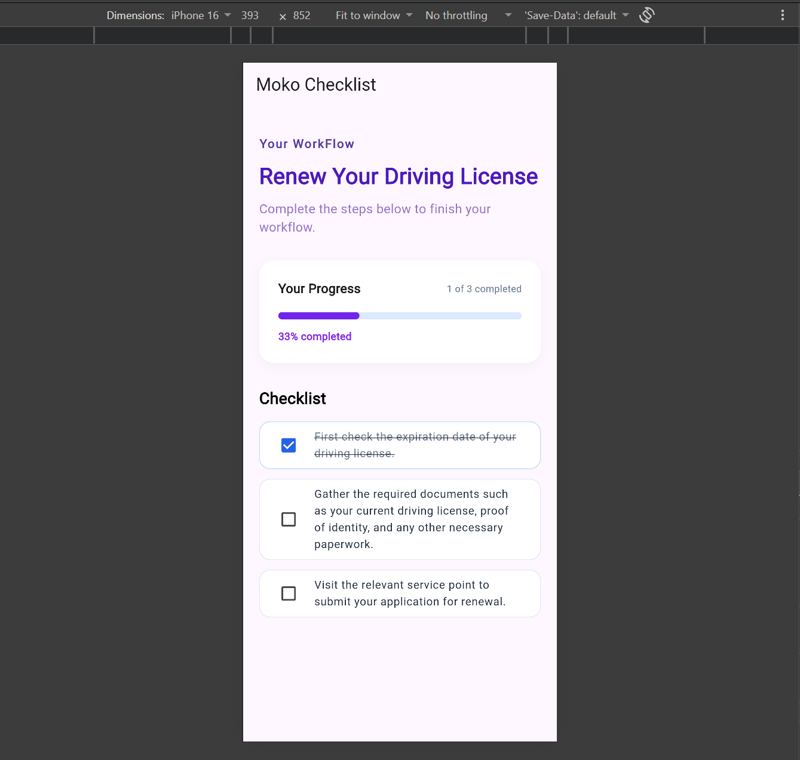
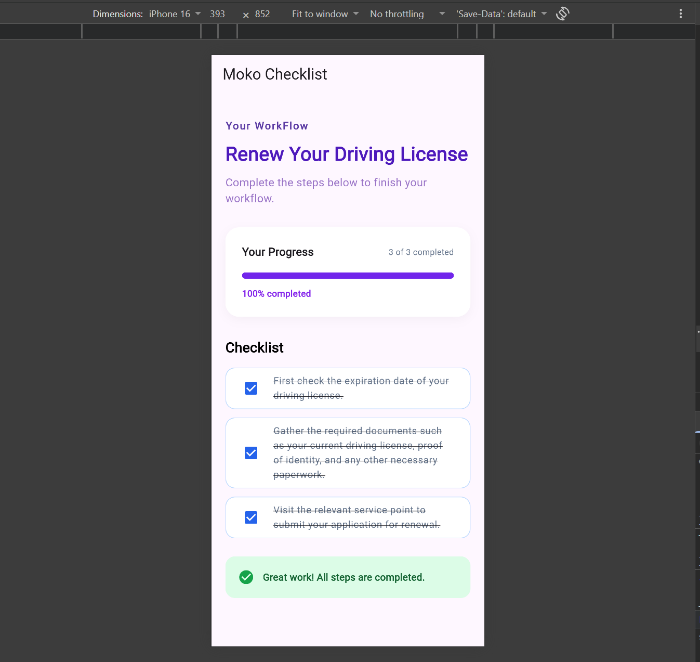

# MOKO Checklist – Flutter Mini Assessment

## Project Overview

MOKO Checklist is a simple Flutter mobile application that displays a dynamic workflow loaded from a local JSON file.

The application allows users to complete checklist items and track their progress through a clean, mobile-friendly interface.

This project was developed as part of the MOKO Mobile Developer Mini Assessment.

## Features

- Dynamic workflow title and checklist items loaded from local JSON.
- Interactive checkboxes to mark steps as completed.
- Progress bar and percentage that update automatically.
- Loading indicator while the workflow is being loaded.
- Error message with a Retry button if loading fails.
- Empty state when no checklist items are available.
- Completion message when all steps are finished.
- Clean, responsive interface using Flutter Material Design.

## Technologies Used

- Flutter
- Dart
- Material Design 3
- Local JSON

## Project Structure

```text
moko_checklist/
├── assets/
│   └── workflow.json
├── lib/
│   ├── main.dart
│   └── workflow.dart
├── pubspec.yaml
└── README.md
```

## App Screenshots

### Initial Checklist


### Completed Checklist


## How to Run

1. Install the Flutter SDK and configure a supported device or emulator.
2. Clone or download this repository.
3. Open the project folder in VS Code or Android Studio.
4. Run the following command to install dependencies:

   `flutter pub get`

5. Start the application:

   `flutter run`

## How It Works

The application loads workflow data from `assets/workflow.json` and converts it into Dart objects using the `Workflow` and `WorkflowStep` models.

Checklist items are generated dynamically rather than hardcoded into the interface.

When the user marks an item as completed, the application updates the checklist state and recalculates the progress percentage.

## How I Would Save Progress Locally

If this became a real application, I would use the `shared_preferences` package to store completed step IDs locally on the device. When the user opens the workflow again, the application would read the saved IDs and restore the completed checklist items. The saved data would be updated whenever a checkbox is selected or deselected, allowing progress to remain available after restarting the application.

## Testing

The following scenarios were tested:

- Loading and displaying workflow data.
- Marking checklist items as completed and incomplete.
- Updating the progress indicator.
- Displaying the completion message.
- Handling an empty checklist.
- Handling invalid JSON with an error state.

## Limitations

Checklist progress is currently stored only in application memory and resets when the application restarts. Persistent storage is described as a potential future improvement but is not implemented in this prototype.

## Author

Kavini Ekanayake

MOKO Mobile Developer Mini Assessment
